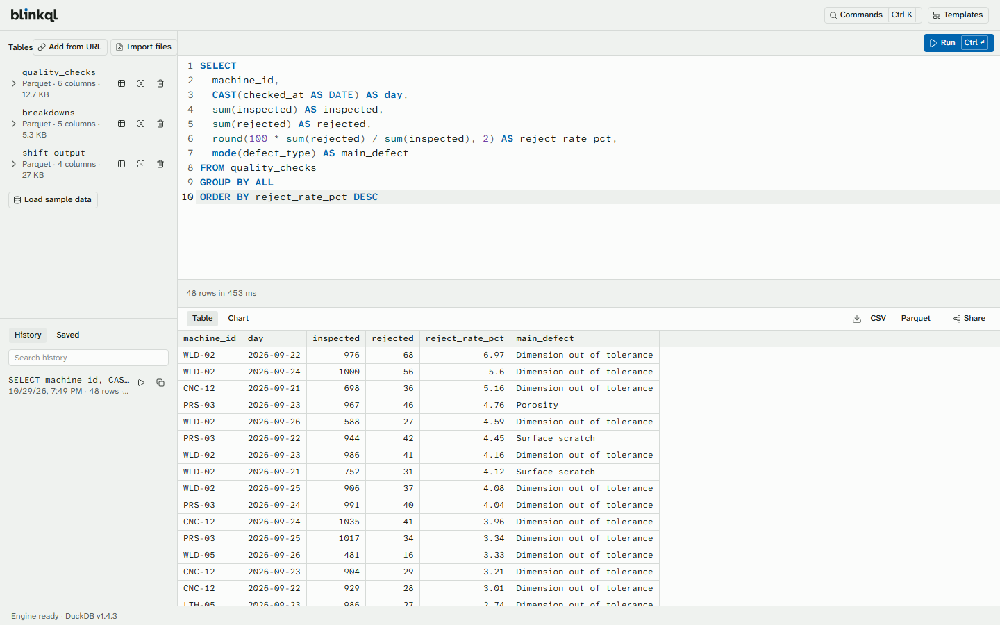
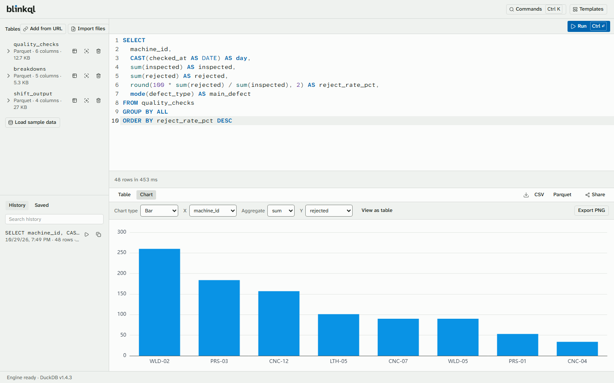

<h1>
<picture>
  <source media="(prefers-color-scheme: dark)" srcset="brand/logo/blinkql-wordmark-dark-animated.svg">
  
</picture>
</h1>

**Queries in the blink of an eye.**

Blinkql is a SQL workbench that runs in your browser. Open a CSV, Excel, Parquet or JSON file, write a query and get your results in milliseconds. The engine runs inside the tab, so your files never leave your computer: no account, no server, no upload.

It's built for the exports operations teams live with, such as machine logs, ERP and MES extracts and sensor dumps of 1–2 million rows, and it comes with ready-made analyses for OEE, downtime and shift reporting.

**[Try it at blinkql.karthik.nz](https://blinkql.karthik.nz/app/)**

<picture>
  <source media="(prefers-color-scheme: dark)" srcset="docs/screenshots/workbench-dark.png">
  
</picture>

## What you can do

- **Import files** in CSV, TSV, Excel (.xlsx, first sheet), Parquet, JSON or NDJSON: drop them on the page, pick them, or give an HTTPS address. Remote Parquet is read in ranges, so only the parts a query needs are downloaded.
- **Keep your files** between visits, where the browser allows it, in storage only Blinkql can read. Convert a CSV table to Parquet in one click to make it smaller and faster to query.
- **Browse and profile tables**: see every column and its type, and profile a table without writing SQL.
- **Write SQL** with autocomplete for DuckDB's keywords and functions and your own tables and columns. Ctrl+Enter runs the query, or just the selected part, and Escape cancels it.
- **Scroll through millions of rows** in a results grid that stays responsive.
- **Chart a result** as a bar, line, scatter, histogram or Pareto chart. Every chart has a text description and can be viewed as a table.
- **Export** results as CSV or Parquet, and charts as PNG.
- **Find past work** in the query history, and keep the queries you come back to as saved queries.
- **Run analysis templates** for operations and logistics: OEE by machine, downtime Pareto, MTTR and MTBF, output by shift, reject rate, two-file reconciliation, data-quality checks, on-time delivery by carrier, delivery lead time by lane, and cost per kg by lane and carrier. Each maps itself to your columns, and you can adjust the mapping. See [Use Cases](https://github.com/Karthik-beta/Blinkql/wiki/Use-Cases) for examples.
- **Learn on sample data**: a made-up factory's week and a quarter of its shipments, generated in the browser, and a three-step tour that takes you from sample data to a chart.
- **Work from the keyboard** with the command palette (Ctrl+K, or ⌘K on a Mac) and a keyboard shortcut reference.
- **Share a query** as a link that carries the SQL and chart settings, never the data.
- **Work offline** once the app has loaded.
- **Use it by keyboard or screen reader**: the workbench targets WCAG 2.2 AA, with automated accessibility checks in light and dark themes, and the theme follows your system's setting.

<picture>
  <source media="(prefers-color-scheme: dark)" srcset="docs/screenshots/chart-dark.png">
  
</picture>

## Privacy

Your files are read by your browser and never leave your device. Blinkql has no backend and no accounts, and it collects nothing about your files, queries or results. A share link holds the query text and chart settings, never data; if your SQL contains literal values, such as an employee ID in a `WHERE` clause, those values are part of the link, and Blinkql points them out before you share. Read more in [Privacy & Security](https://github.com/Karthik-beta/Blinkql/wiki/Privacy-and-Security).

## Quick start

### Use it

1. Open [blinkql.karthik.nz/app](https://blinkql.karthik.nz/app/). There is nothing to install.
2. Click **Take the tour** to load sample data, query it and chart it in three steps, or drop a CSV, Excel, Parquet or JSON file onto the page.
3. Write SQL in the editor and press Ctrl+Enter (⌘+Enter on a Mac) to run it.

### Develop it

You need Node.js 26 and pnpm.

```bash
git clone https://github.com/Karthik-beta/Blinkql.git
cd Blinkql
pnpm install
pnpm dev
```

The workbench opens at http://localhost:5173/app/. The [contributing guide](CONTRIBUTING.md) covers installing pnpm, the tests and checks, benchmarks and the pull request workflow.

## Browser support

The latest two versions of Chrome, Edge, Firefox and Safari on desktop; see [Browser Support & Limitations](https://github.com/Karthik-beta/Blinkql/wiki/Browser-Support-and-Limitations) for memory limits, remote files and storage.

## Help build it

You don't need to write code to make a difference. Run the benchmarks on your hardware, share synthetic datasets or analysis templates from your industry, review the design and accessibility, or pick up a [good first issue](https://github.com/Karthik-beta/Blinkql/issues?q=is%3Aopen+label%3A%22good+first+issue%22).

- [Contributing guide](CONTRIBUTING.md): setup, workflow and pull request checklist
- [Discussions](https://github.com/Karthik-beta/Blinkql/discussions): questions, use cases and ideas
- [Wiki](https://github.com/Karthik-beta/Blinkql/wiki): vision, architecture, design language and benchmarks
- [Roadmap](https://github.com/Karthik-beta/Blinkql/wiki/Roadmap-and-Milestones): what's done and what's next
- [Code of conduct](CODE_OF_CONDUCT.md) and [security policy](SECURITY.md)

## Licence

[MIT](LICENSE)

<sub>Blinkql is an independent open-source project. It is not affiliated with or endorsed by DuckDB Labs or the DuckDB Foundation. "DuckDB" is a trademark of the DuckDB Foundation.</sub>
