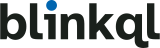
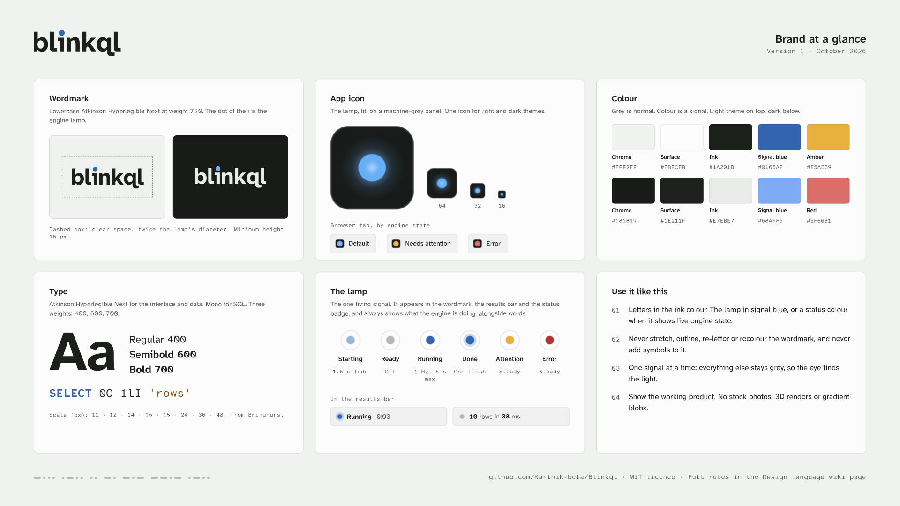

<picture>
  <source media="(prefers-color-scheme: dark)" srcset="logo/blinkql-wordmark-dark.svg">
  
</picture>

# Brand assets

Everything Blinkql needs to look like itself: the logo, the app icon, favicons, link previews, social images, a brand sheet and a slide template. Every asset follows the [Design Language](https://github.com/Karthik-beta/Blinkql/wiki/Design-Language) and uses colours from the [Design Tokens](https://github.com/Karthik-beta/Blinkql/wiki/Design-Tokens). The thinking behind the look is in [PHILOSOPHY.md](PHILOSOPHY.md).



## What's here

| File | Use it for |
|---|---|
| [`logo/blinkql-wordmark-light.svg`](logo/blinkql-wordmark-light.svg) | The logo on light backgrounds |
| [`logo/blinkql-wordmark-dark.svg`](logo/blinkql-wordmark-dark.svg) | The logo on dark backgrounds |
| [`logo/blinkql-wordmark-black.svg`](logo/blinkql-wordmark-black.svg), [`-white.svg`](logo/blinkql-wordmark-white.svg) | One-colour printing, engraving, and partner logo walls that require a single colour |
| [`logo/blinkql-wordmark-*-animated.svg`](logo/blinkql-wordmark-light-animated.svg) | README and landing page. The lamp blinks five times, then stays lit. It stays still when the viewer has reduced motion turned on. |
| `logo/*.png` | The same logos as 1200 px PNGs, for tools that can't take SVG |
| [`icon/blinkql-icon.svg`](icon/blinkql-icon.svg), [`-1024.png`](icon/blinkql-icon-1024.png) | The app icon, with rounded corners |
| [`icon/blinkql-icon-square.svg`](icon/blinkql-icon-square.svg), [`-1024.png`](icon/blinkql-icon-square-1024.png) | Profile pictures (GitHub organisation, X, LinkedIn, Discord) and anywhere that applies its own mask. The lamp is centred, so a circle crop works. |
| [`web/`](web) | Favicons, PWA icons, the web manifest, the link-preview image and the `<head>` tags. See [Web setup](#web-setup). |
| [`social/github-social-preview.png`](social/github-social-preview.png) | The repository's social preview (1280 × 640) |
| [`social/social-banner.png`](social/social-banner.png) | Profile header for X, Bluesky and Mastodon (1500 × 500, 3:1) |
| [`brand-sheet.png`](brand-sheet.png), [`.pdf`](brand-sheet.pdf) | Brand at a glance, for press kits, partners and new contributors |
| [`slides/blinkql-slides.pdf`](slides/blinkql-slides.pdf) | Slide template with seven layouts: title, section, content, code, one number, product and close |
| [`source/`](source) | Vector PDF masters of the social images, ready for print or for re-importing into Canva |

## The pieces

### Wordmark

"blinkql" in lowercase Atkinson Hyperlegible Next at weight 720, with the dot of the i replaced by the engine lamp. It's drawn from the font's outlines, so it never depends on the font being installed.

- Minimum height is 16 px. Leave clear space of twice the lamp's diameter on every side.
- The letters use the ink colour. The lamp is signal blue, or a status colour when it shows live engine state.
- Never stretch, outline, re-letter or recolour it, and never add symbols to it.

### App icon

The lamp, lit, on a machine-grey panel. We compared four candidates at 192, 32 and 16 px:

- the lamp alone
- a panel of nine lamps with one lit
- the letter i
- a q with a lit counter

The panel read as an app launcher grid. The i read as an "information" sign. The q added a second brand device. The lamp alone stayed clear at 16 px and keeps the brand to a single idea, the lamp.

- **One icon for every theme.** The dark panel stands out on both light and dark browser tabs, and a lit lamp reads best on a dark panel, as in a control room. Using one icon everywhere also makes it easier to recognise.
- **Two drawings, one design.** The 16–48 px favicons use a larger lamp and no bezel, so the light survives at small sizes. App icons and avatars use the full drawing, with its bloom and hairline bezel.

### Favicons that show engine state

When a long query runs in a background tab, the tab icon can show the engine state, the same way the lamp does in the product:

| State | File | Tab title (words carry the meaning too) |
|---|---|---|
| Default | `favicon.svg` | `Blinkql` |
| Needs attention | `favicon-attention.svg` | `Needs attention · Blinkql` |
| Error | `favicon-error.svg` | `Query failed · Blinkql` |

```ts
const tabIcon = document.querySelector<HTMLLinkElement>('link[rel="icon"][type="image/svg+xml"]')!;
export function setTabState(state: 'default' | 'attention' | 'error') {
  tabIcon.href = state === 'default' ? '/favicon.svg' : `/favicon-${state}.svg`;
}
```

Running and done have no favicon of their own. They're normal states, and the tab title already says "Running 0:12". Switch back to the default icon as soon as the tab is visible again.

### Social images

- **GitHub social preview and Open Graph image:** the wordmark, the one-line pitch, and the working product with its timing readout, as the Design Language's marketing rules ask. They're dark because a lit lamp reads best on a dark panel, and a dark card stands out in both light and dark feeds.
- **Banner:** a field of unlit lamps, with the wordmark's lamp sitting on one of the grid points. The lower left stays empty because X, Bluesky and Mastodon put the profile picture there.

### Recurring elements

- **The lamp field:** a grid of unlit indicators, like an annunciator panel or the rows and columns of a table. One lamp is lit at most.
- **The timing strip:** the row of dots and dashes along the bottom of the social images, banner, sheet and slides spells *blinkql* in Morse code: the brand, blinking. Keep it quiet, in the lamp-off grey, and never use it as a heading or divider.
- **The lamp as a full stop:** large headlines end in the lamp, as in the Design Language's headline treatment.

## Web setup

When the app is scaffolded:

1. Copy everything in [`web/`](web) except `head.html` into `public/`.
2. Paste the tags from [`web/head.html`](web/head.html) into `index.html`'s `<head>`.
3. If the app has a manual theme switch, update `<meta name="theme-color">` to the chrome colour when the theme changes (`#EFF2EF` light, `#181B19` dark). The media-query tags only follow the system setting.
4. When offline support arrives with `vite-plugin-pwa`, move the fields from `site.webmanifest` into the plugin's `manifest` option. The maskable icon keeps the lamp inside the 80% safe zone.

Why these files: `favicon.ico` (16, 32 and 48 px) covers older browsers and tools that only fetch `/favicon.ico`, and `sizes="32x32"` stops Chrome preferring it over the SVG. `favicon.svg` is sharp at any size. `apple-touch-icon.png` is full-bleed because iOS applies its own corner mask. Safari's `mask-icon` and Windows tiles (`browserconfig.xml`) are left out because current browsers no longer use them.

To set the repository's social preview, go to **Settings → General → Social preview → Edit → Upload an image** and choose `social/github-social-preview.png`. GitHub has no API for this.

## Editing in Canva

Editable copies of the social images, the brand sheet and the slide template are in the maintainers' Canva folder *Blinkql brand*, with the logos and icons uploaded next to them. Canva doesn't include Atkinson Hyperlegible, so text in those designs is converted to vector outlines to keep the typography exact.

To change wording, either:

- add a text box in Canva, after uploading Atkinson Hyperlegible Next and Mono as brand fonts (a paid Canva feature; the fonts are free from [Fontsource](https://fontsource.org/fonts/atkinson-hyperlegible-next) and Google Fonts), or
- ask for the asset to be regenerated from the masters.

Export PNG from Canva at the sizes in the table above.

## How these were made

The SVGs are drawn from the Atkinson Hyperlegible Next outlines (weight 720) with fontTools, using colours from the Design Tokens. Rasters were rendered with headless Microsoft Edge. Composed pieces were built as vector PDFs and imported into Canva. The PNGs in `social/`, `web/og-image.png` and `brand-sheet.png` are Canva exports. The design philosophy was written first, following Anthropic's [canvas-design](https://github.com/anthropics/skills/tree/main/skills/canvas-design) skill.

## Deliberately not included

| Not here | Why |
|---|---|
| Illustrations, mascots, stock photos | The Design Language rules them out. The product is the marketing. |
| Custom UI icons | The interface uses lucide at stroke 1.75 ([ADR-009](https://github.com/Karthik-beta/Blinkql/wiki/Architecture-Decision-Records)) |
| Icon and wordmark lockup | The wordmark is the logo, and the icon stands in only where the word won't fit. One mark at a time keeps the brand simple. |
| PWA install screenshots | They should show the real product. Add them with offline support in M6. |
| Stickers and merchandise | Easy to make from the SVGs when there's an event |
